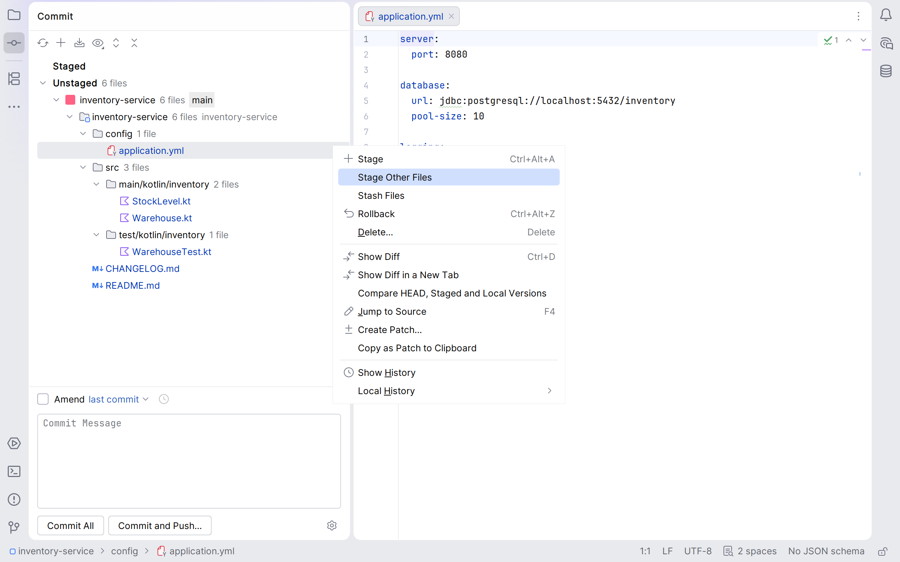

# Stage Other Files

JetBrains IDE plugin that stages every unstaged file except the ones you select in the Git staging
area.

<picture>
  <source media="(prefers-color-scheme: dark)" srcset="marketplace/screenshots/context-menu-dark.png">
  
</picture>

## Use

1. Enable the staging area, which is off by default: **Settings | Version Control | Git | Enable
   staging area**.
2. In the **Commit** tool window, select one or more unstaged files or folders.
3. Right-click and choose **Stage Other Files**, directly below **Stage**.

Every other modified tracked file, in every Git repository of the project, is staged. The selected
files stay unstaged, including the unstaged changes of a partially staged file. Unversioned files,
listed in red under Unstaged, and conflicted files are never staged.

Works in IntelliJ IDEA 2024.2 and later, and in every other IntelliJ-based IDE that bundles Git.

## Build

Requires JDK 21; Gradle downloads it if none is installed.

```bash
./gradlew build         # compile and test
./gradlew buildPlugin   # plugin zip in build/distributions/
./gradlew runIde        # sandbox IDE with the plugin installed
```

## Licence

[MIT](LICENSE)
